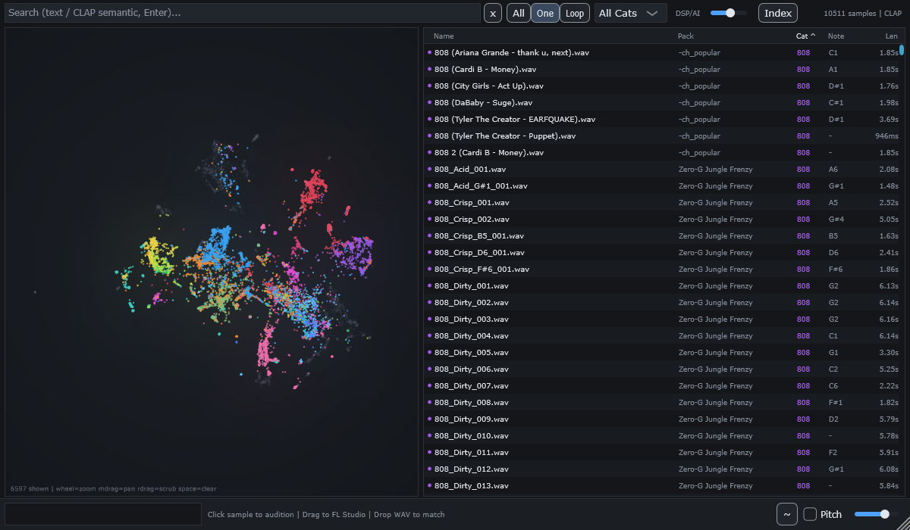

# sample-vector-db

A fast, barebones audio sample vectorizer and 2D similarity-map browser for FL Studio (built with C++20, JUCE 8, SQLite3, and ONNX Runtime + DirectML).



## Features

- **Hybrid Audio Vectorization (DSP + CLAP):**
  - **Phase 1 — C++ DSP (64D):** Onset-trimmed 3-slice temporal log-mel energies (attack / body / tail, 30 Hz–18 kHz), envelope/spectral/stereo descriptors, YIN musical pitch detection, envelope-based oneshot vs. loop detection, and cached 96-bin waveform peaks.
  - **Phase 2 — CLAP Neural Embeddings (512D):** Runs `Xenova/clap-htsat-unfused` ONNX models locally via ONNX Runtime with DirectML GPU acceleration (automatic CPU fallback) for natural-language semantic search (e.g. `"punchy analog kick drum"`, `"deep sub bass rumble"`) and zero-shot auto-tagging across **18 categories** (`Kick`, `Snare`, `Rim`, `Clap`, `Closed Hat`, `Open Hat`, `Cymbal`, `Tom`, `Perc`, `808`, `Bass`, `Synth`, `Chord`, `Stab`, `Vocal`, `Foley`, `Riser`, `Impact`).
  - Graceful fallback to DSP-only mode if ONNX Runtime DLLs or CLAP models are not installed.
- **Live-Morphing 2D Similarity Map:**
  - Pure C++ PCA + parallel kNN + UMAP SGD computes **3 Procrustes-aligned 2D layouts** (`0.0` DSP, `0.5` Hybrid, `1.0` CLAP).
  - Dragging the **DSP/AI** slider smoothly morphs the 2D point cloud in real time while also blending Find Similar rankings.
- **FL Studio Workflow (VST3 Instrument + Standalone):**
  - Native Windows `CF_HDROP` drag-and-drop straight from the list, 2D map, or waveform bar onto FL Studio's **Channel Rack** or **Playlist**.
  - Lock-free 4-voice audition sampler playable via clicks, arrow keys, right-drag scrubbing, or MIDI (`C5` / MIDI 60 = original pitch, optional chromatic `Pitch` mode).
  - Drop any external `.wav`/`.mp3`/`.flac`/`.aiff`/`.ogg` onto the window to find similar samples in your library.
  - Standalone executable includes a **Pin** (always-on-top) toggle to float alongside FL Studio.

## Controls

| Action | Behavior |
|---|---|
| **Left-click** dot / row | Select and audition sample |
| **Right-drag (`rdrag`)** on map | Scrub-audition across the point cloud (single-voice) |
| **Middle-drag (`mdrag`)** on map | Pan map (left-drag on empty space also pans) |
| **Mouse wheel** on map | Zoom around cursor (`R` resets view) |
| **Left-drag** dot / row / waveform | Drag sample file directly into FL Studio |
| **Double-click** dot / row (or `S` / `~`) | Find Similar samples |
| **Spacebar** | Clear active Find Similar filter |
| **Click waveform** (bottom-left) | Start playback at clicked position |
| **Click column header** (`Name`, `Pack`, `Cat`, `Note`, `Len`, `Sim`) | Sort ascending / descending |

## Build (Windows)

Requires **Visual Studio Build Tools (C++20 + CMake + Ninja)**. Dependencies (JUCE 8, SQLite3, nlohmann/json, ONNX Runtime DirectML) are fetched automatically on first configure.

```powershell
.\build.ps1                             # Release build (all targets)
.\build.ps1 -Debug                      # Debug build
.\build.ps1 -Target svdb-index          # Build a single target
```

### Installing the VST3 for FL Studio

`build.ps1` copies the VST3 bundle to `%USERPROFILE%\VST3-dev\sample-vector-db.vst3` and places `onnxruntime.dll` / `DirectML.dll` in `%APPDATA%\sample-vector-db\runtime\` (kept outside the `.vst3` bundle so DAW VST2 scanners never mistake them for plugins).

Because FL Studio scans VST3 plugins from `C:\Program Files\Common Files\VST3`, link it once in an **Administrator PowerShell**:

```powershell
New-Item -ItemType Junction `
  -Path "C:\Program Files\Common Files\VST3\sample-vector-db.vst3" `
  -Target "$env:USERPROFILE\VST3-dev\sample-vector-db.vst3"
```

Then run **Options → Manage Plugins → Find installed plugins** in FL Studio and load `sample-vector-db` under **Generators → VST3**.

*(FL Studio locks the `.vst3` while loaded — remove the channel or close FL Studio before rebuilding.)*

## CLI Usage (`svdb-index`)

Data and downloaded models are stored under `%APPDATA%\sample-vector-db\`.

```powershell
$idx = ".\build\Release\svdb-index_artefacts\Release\svdb-index.exe"

# 1. Download Xenova/clap-htsat-unfused ONNX models once (~590 MB)
& $idx download-models

# 2. Index a sample library incrementally (DSP + CLAP DirectML + 3 aligned 2D maps)
& $idx scan "C:\path\to\your\Samples"

# 3. Query / inspect from CLI
& $idx stats
& $idx query "punchy analog kick drum" --oneshots --top 10
& $idx similar "C:\path\to\reference.wav" --blend 0.55 --top 10

# 4. Recompute categories/loop flags or 2D maps without re-running audio embeddings
& $idx retag
& $idx layout

# 5. Auto-name unlabeled sample packs using CLAP + YIN + 5ms transient-comb BPM detection
& $idx autoname "C:\path\to\pack" --preview 20
& $idx autoname "C:\path\to\pack" --apply --out "C:\path\to\renamed"
```

## Other Tools

| Binary | Purpose |
|---|---|
| `sample-vector-db.exe` | Standalone floating sample browser (`build\Release\SampleVectorDB_artefacts\Release\Standalone\`) |
| `svdb-index.exe` | CLI indexer, model downloader, semantic query, retag, layout, and auto-namer |
| `svdb-tests.exe` | Unit tests covering DSP/YIN, CLAP mel frontend, RoBERTa BPE tokenizer, SQLite WAL, AVX2 search, and UMAP layout |
| `svdb-ui.exe` | Offscreen PNG snapshot renderer for UI verification |

## License

Licensed under the [GNU Affero General Public License v3.0](LICENSE) (compatible with JUCE 8 open-source licensing).
